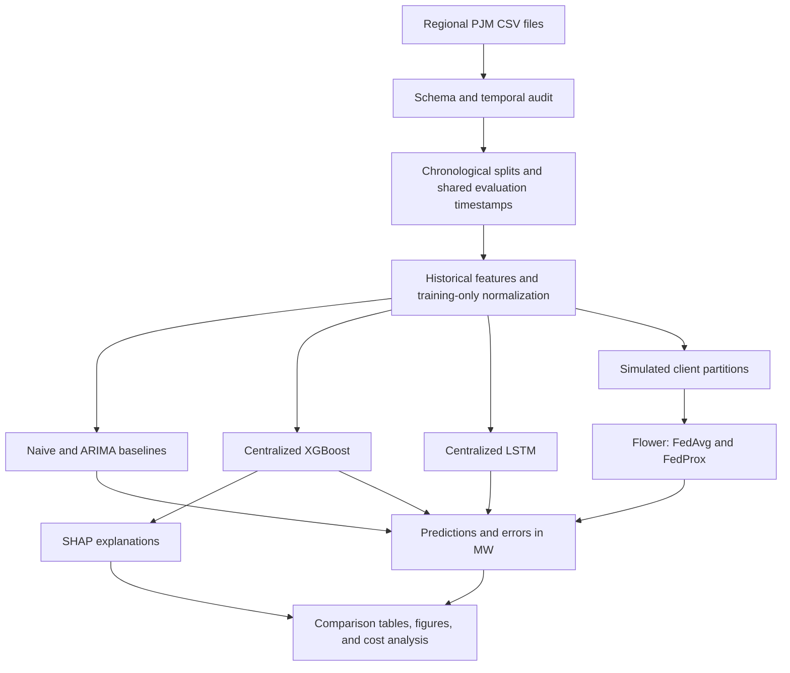

# Federated Energy Forecasting

**Explainable hourly electricity-load forecasting with XGBoost, LSTM, Flower, and SHAP.**

[](https://github.com/Nour-Ghribi/federated-energy-forecasting/actions/workflows/tests.yml)


## The idea

Electricity demand changes with daily routines, weekly patterns, and seasonal conditions. Forecasting that demand helps inform capacity planning, energy management, and operational decisions. A useful forecasting system should also make its predictions understandable and account for how data are distributed across different regions.

This project brings four questions into one reproducible workflow:

- **Predict:** compare statistical references, gradient-boosted trees, and recurrent neural networks for one-hour-ahead load forecasting.
- **Collaborate:** train a shared LSTM across simulated clients using FedAvg and FedProx, including heterogeneous regional distributions.
- **Explain:** use SHAP to examine how historical and calendar variables influence XGBoost predictions.
- **Compare:** measure forecasting errors alongside training duration, optimization budgets, and estimated parameter communication.

The approach connects time-series modeling, distributed optimization, and explainable AI. Its relevance extends to energy analytics, smart-grid research, and forecasting applications where observations are distributed across multiple sites.

## Architecture



## Forecasting approach

The task is to predict the next source civil-hour load using observations available at the prediction origin. Evaluation follows a rolling one-step protocol: each newly observed load can become history for the next forecast.

|Model|Representation|Role|
|---|---|---|
|Naive|Most recent observed load|Persistence reference|
|Seasonal naive|Load from the previous day or week|Seasonality references|
|ARIMA|Autoregressive and moving-average structure|Statistical reference with bounded AIC order selection|
|XGBoost|Historical lags, rolling statistics, and calendar variables|Nonlinear tabular forecasting and SHAP analysis|
|LSTM|Sliding windows of normalized historical load|Sequence modeling, centralized and federated|

XGBoost receives lags of 1, 24, 48, and 168 hours, rolling means and standard deviations, hour, weekday, month, weekend indicators, and cyclical calendar encodings. Historical rolling statistics are shifted to exclude the target hour.

The PyTorch LSTM maps inputs of shape `[batch, sequence_length, 1]` through recurrent layers and a regression head. Training uses Adam, gradient clipping, early stopping, and restoration of the best checkpoint. Predictions are converted back to MW before evaluation.

## Federated learning

Clients perform local LSTM optimization, and the Flower server aggregates their updates. Centralized and federated neural models share the same architecture.

**FedAvg** weights each client's model by its number of training examples:

$$
w^{r+1} = \sum_{k=1}^{K} \frac{n_k}{\sum_j n_j} w_k^{r+1}.
$$

**FedProx** adds a squared L2 penalty that discourages excessive movement away from the global model during local optimization:

$$
\mathcal{L}_k(w) = \mathcal{L}_{\mathrm{prediction},k}(w) + \frac{\mu}{2}\lVert w-w^r\rVert_2^2.
$$

Global reference parameters remain detached throughout local optimization. Tests check agreement between FedAvg and FedProx at `mu = 0` under identical initialization, data, minibatch order, and hyperparameters.

|Client scenario|Construction|Analysis|
|---|---|---|
|IID-like|Approximately uniform assignment of training windows|Balanced sample distributions, with correlated and overlapping histories documented|
|Temporal heterogeneity|Successive chronological blocks|Changes in load regimes and seasonality|
|Regional heterogeneity|PJME, AEP, COMED, and DAYTON|Differences between regional load distributions|

Client diagnostics include sample counts, coverage, moments, quantiles, hourly profiles, and normalized Wasserstein distances. A common training-only scaler provides the multiregion reference; local regional scalers form a separate representation analysis. Regional errors are always computed after denormalization.

Clients are simulated research partitions. Flower messages exchange model parameters; federated learning by itself does not establish differential privacy.

## Explainability with SHAP

TreeExplainer uses a background drawn from training data and the trees retained by XGBoost's early stopping. It produces:

- Global feature importance and SHAP summary plots.
- Local waterfall explanations for individual forecasts.
- Dependence plots for influential variables.
- Feature-attribution comparisons across periods.

SHAP contributions explain how the model moves from its reference prediction to a particular forecast. Correlated lag variables can share information and affect attribution stability. The contributions describe predictive associations.

## Evaluation and reproducibility

The protocol fixes chronological periods and eligible evaluation timestamps before training. Every model must predict the same evaluation observations. Preprocessing and scaling are fitted on training data only. Missing and ambiguous source hours are documented and masked, with affected windows excluded explicitly.

- **Accuracy:** MAE and RMSE in MW, plus sMAPE with a defined zero-denominator convention.
- **Regional reporting:** per-region errors, macro averages, and pooled metrics.
- **Repeated runs:** seeds `42`, `43`, and `44`, with mean and sample standard deviation.
- **Compute:** training and inference duration, examples processed, optimizer updates, communication rounds, and estimated parameter payload.
- **Traceability:** resolved YAML/JSON, source-data hashes, software versions, checkpoints, predictions, and PNG/PDF figures.

Training data access and resource budgets accompany the comparisons. ARIMA uses a bounded 90-day training window. The regional study uses a predefined start of 2013-06-01, or the later profile start, shared by its centralized and federated models. Validation and test boundaries follow the selected profile.

## Getting started

Use Python 3.11 or 3.12:

```bash
git clone https://github.com/Nour-Ghribi/federated-energy-forecasting.git
cd federated-energy-forecasting
python -m venv .venv
```

Activate the environment with `source .venv/bin/activate` on Linux/macOS, or `.\.venv\Scripts\Activate.ps1` in Windows PowerShell, then install:

```bash
python -m pip install -e .
```

Download the [PJM hourly energy consumption dataset](https://www.kaggle.com/datasets/robikscube/hourly-energy-consumption) and place the regional CSVs in `data/raw/` or at the repository root:

```text
data/raw/
  PJME_hourly.csv
  AEP_hourly.csv
  COMED_hourly.csv
  DAYTON_hourly.csv
```

The loader detects timestamp and target columns and requires declared MW units. CSVs remain local and are excluded from Git. Check the source terms before redistributing data. Official operator reference: [PJM Data Miner 2](https://www.pjm.com/markets-and-operations/etools/data-miner-2).

### Centralized forecasting and explanations

```bash
energy-forecast prepare --profile cpu-light
energy-forecast train --model xgboost --profile cpu-light
energy-forecast train --model lstm --profile cpu-light
energy-forecast shap --profile cpu-light
energy-forecast summarize --output-dir results
```

### Flower simulations

Use a Linux environment, including WSL2 on Windows, for the Flower/Ray simulation runtime:

```bash
python -m pip install -r requirements-simulation.txt
energy-forecast federated --model fedavg --profile cpu-light
energy-forecast federated --model fedprox --mu 0.01 --profile cpu-light
```

Local epochs and communication rounds are configured separately. Validation metrics are recorded after every round. The profiles `smoke`, `cpu-light`, `gpu`, and `full` expose explicit budgets in [`configs/profiles/`](configs/profiles/). The GPU profile uses a CUDA-compatible PyTorch installation. The `inprocess` transport is restricted to functional smoke checks.

### Experiment matrix

```bash
energy-forecast experiment --experiment 1 --profile full
energy-forecast experiment --experiment all --profile full
```

|Experiment|Question|
|---|---|
|1. Forecasting comparison|How do naive, seasonal, ARIMA, XGBoost, and LSTM forecasts compare?|
|2. Neural sensitivity|How do sequence length and hidden size affect the LSTM?|
|3. Federated comparison|How do centralized LSTM, FedAvg, and FedProx compare?|
|4. Heterogeneity|How do client partitions, proximal coefficients, and normalization choices affect behavior?|
|5. Explainability|Which variables influence XGBoost forecasts globally, locally, and across periods?|
|6. Computational trade-offs|How do forecasting errors relate to measured training costs?|

Use `--seed 42` to select one seed; otherwise the configured three seeds are used.

### Checkpoint inference

```bash
energy-forecast infer --checkpoint results/RUN/model.pt --input new_PJME.csv --region PJME
energy-forecast infer --checkpoint results/RUN/PJME_xgboost.ubj --input new_PJME.csv --region PJME
```

Supply the observed hourly context needed by the model. Neural checkpoints preserve architecture and regional scales; XGBoost checkpoints have a companion feature schema.

## Project structure

```text
configs/                  Model settings, profiles, and experiment definitions
src/pulse_predict/        Data, models, federation, evaluation, SHAP, and CLI
scripts/                  Task entry points and reproducibility checks
notebooks/                EDA, forecasting, federation, and explainability
tests/                    Temporal integrity and model integration tests
reports/                  Methodology and technical explanations
docs/                     Architecture and reproducibility details
.github/workflows/        Automated test jobs
data/                     Local source and processed data
results/                  Local experiment artifacts
```

The existing `pulse` command remains available as a compatibility alias for scripts and notebooks.

## Documentation and tests

- [Research methodology and references](reports/methodology.md)
- [Experiment protocol](reports/experiments.md)
- [Architecture](docs/architecture.md)
- [Reproducibility](docs/reproducibility.md)
- [French technical explanation and interview guide](reports/interview_explanation_fr.md)

```bash
python -m pytest -q
python scripts/validate_project.py --matrix
python scripts/check_federated_equivalence.py --results results/validated
```

Tests cover historical-feature causality, chronological splits, training-only normalization, sequence boundaries, tensor shapes, metrics, weighted aggregation, FedProx gradients, checkpoint loading, and inference.

## Foundations

- Chen & Guestrin - [XGBoost](https://arxiv.org/abs/1603.02754)
- Hochreiter & Schmidhuber - [Long Short-Term Memory](https://doi.org/10.1162/neco.1997.9.8.1735)
- McMahan et al. - [Federated Averaging](https://proceedings.mlr.press/v54/mcmahan17a.html)
- Li et al. - [Federated Optimization in Heterogeneous Networks](https://arxiv.org/abs/1812.06127)
- Lundberg & Lee - [SHAP](https://arxiv.org/abs/1705.07874)
