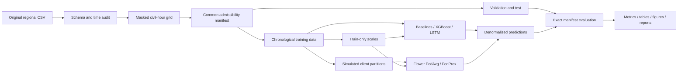

# Architecture and contracts

`data.py` owns schema validation, audits, features, admissibility manifests and
training-only scales. `models.py` owns all centralized estimators and the exact
local neural optimization reused by federated clients. `federated.py` owns client
partitioning, training-distribution diagnostics and Flower apps/strategies.
`evaluation.py` enforces finite MW predictions and exact timestamp equality.
`runner.py` persists experiment artifacts; `cli.py` exposes the reproducible entry
points. `figures.py` and `explainability.py` consume computed arrays.

The internal `Samples` contract contains an hourly target series, tabular feature
matrix, integer indices by split and a sequence length. At target index t, an
LSTM window is `[t-L:t]`, excluding y[t]. Input shape is `[B,L,1]`; the LSTM emits
`[B,L,H]`, its last output is `[B,H]`, and the linear head produces `[B]`.

Checkpoints contain network architecture, state_dict, sequence length and named
regional scales. XGBoost UBJ checkpoints have a companion feature schema. No
absolute data path is embedded in either checkpoint format.

Validation is used for stopping/checkpoint selection; test is used only after
selection. Flower evaluates validation after every round. Model parameters are
aggregated in float tensors; raw observations are not sent through Flower
messages. All clients are simulated in one trusted environment, which may hold
all CSVs and therefore is not a production privacy boundary.
